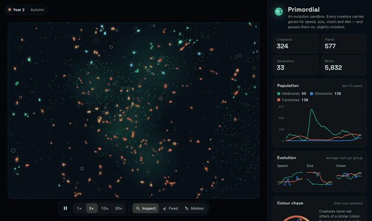
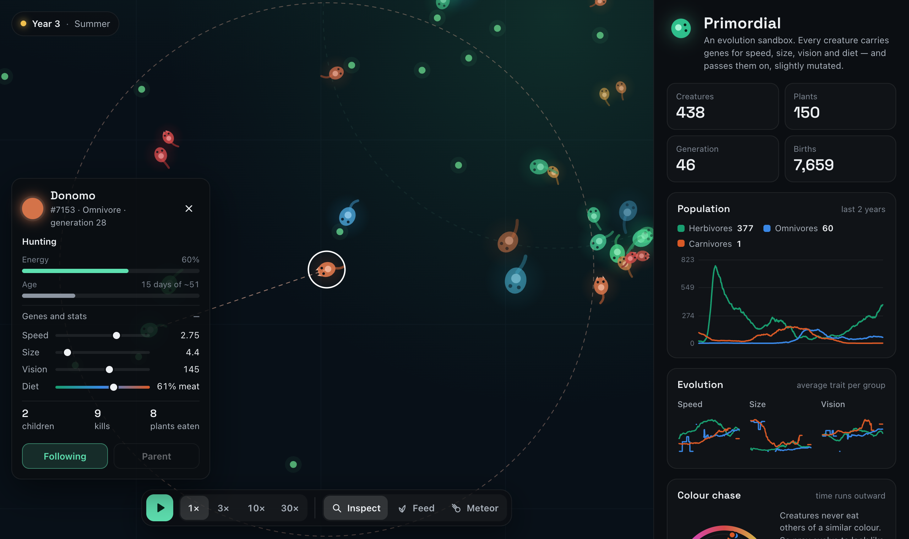

<div align="center">

# Primordial

**An evolution sandbox that runs in your browser.**<br>
Predators and prey with inheritable genes compete, hunt, hide and evolve in real time. Nothing is scripted.

[**▶ Open the live demo**](https://aldikosh23.github.io/primordial/)



</div>

## What you are looking at

Every glowing dot is a creature with five genes: **speed**, **size**, **vision**, **diet** and **colour**. Creatures burn energy to live, move and see. They eat plants or each other, and once they have stored enough energy they split, passing a slightly mutated copy of their genes to a child.

That's the whole rulebook. Whoever eats well has more children, so their genes spread. Everything interesting below *emerges* from it.



## Things that evolve on their own

These showed up in headless test runs without being programmed in:

- **An arms race in speed.** Prey start slow (1.8). With hunters around they are at 3.0–3.6 by the end of the first in-game year, and hunters speed up to keep pace.
- **Relaxed selection.** When hunters die out, speed stops paying for itself: prey slowly get *slower* again (in the world [`umber-marsh-702`](https://aldikosh23.github.io/primordial/?seed=umber-marsh-702) hunters vanish in year 2 and prey speed drifts from 3.7 to 2.9 over the next eight years) because a fast body costs energy even at rest. Their colour stops drifting too: nothing selects on it any more.
- **Predator–prey cycles.** Populations oscillate out of phase, the textbook Lotka–Volterra pattern: prey boom, hunters feast and multiply, prey crash, hunters starve.
- **Diets re-evolve.** Plant-eaters drift into omnivores, and omnivores into full carnivores, sometimes years after the original carnivores went extinct.
- **The colour chase.** Creatures never eat others of a similar colour. So prey evolve to *look like their hunters* (mimicry), and hunters evolve to look different. The whole ecosystem slowly spins around the colour wheel, prey trailing hunters by about 20°. It's an endless arms race, the kind biologists call the **Red Queen effect**. The *Colour chase* chart shows it as a spiral.

The default world tells the whole story if you let it run (at 30× it takes a minute or two): hunters and prey chase each other around the colour wheel for a decade, the carnivores die out around year 11, the prey population explodes and slowly loses its speed, and around year 16 omnivores start evolving into a new generation of carnivores.

Every world is seeded, so any of this can be replayed exactly, in any browser: copy the link and anyone who opens it gets the same starting world (with your settings).

## Playing with it

| Action | How |
| --- | --- |
| Pause / play | <kbd>Space</kbd> or the ▶ button |
| Speed 1× / 3× / 10× / 30× | <kbd>1</kbd>–<kbd>4</kbd> (1× is 60 ticks a second on any display) |
| Inspect a creature | <kbd>I</kbd>, then click one: genes, energy, age, kills, children; **Follow** keeps the camera on it |
| Close the card / back to Inspect | <kbd>Esc</kbd> |
| Drop food | <kbd>F</kbd>, then click or drag |
| Meteor strike | <kbd>M</kbd>, then click. Watch who recovers |
| Zoom / pan | scroll or pinch / drag |
| Reset the view | double-click empty space or <kbd>0</kbd> |
| Tune the world | food growth, mutation strength and seasons in the side panel |
| New world / share | buttons at the bottom of the panel; the URL holds `?seed=` and any changed settings |

## How it works

### Genes and what they cost

| Gene | Range | Helps with | Costs |
| --- | --- | --- | --- |
| Speed | 0.5 – 4 | reaching food first, catching prey, escaping | energy per tick ∝ mass<sup>0.7</sup> · v² while moving, plus muscle upkeep even at rest |
| Size | 3 – 14 | hunting (you can only eat creatures no bigger than you), more energy storage | higher metabolism (∝ mass<sup>0.75</sup>), slower turning, later maturity; harder to hide |
| Vision | 20 – 240 | spotting food and threats earlier | energy per tick ∝ range |
| Diet | 0 – 1 | 0 = grazer, 1 = pure hunter | digestion is a trade-off: plant efficiency (1 − d)<sup>1.3</sup>, meat efficiency d<sup>1.3</sup> |
| Colour | 0 – 360° | nothing directly: similar colours never eat each other | none |

### Behaviour

Each tick a creature looks around within its vision range and picks one goal:

1. **Flee** if a hunter that could eat it is close, steering away from all threats weighted by distance.
2. **Hunt** or **forage**: go for the most valuable food per unit of distance (plants, or prey it can catch).
3. **Wander** otherwise, at a relaxed pace to save energy.

Hunters **pounce** (a short burst of extra speed) when they get close. Eating takes a moment, and a grazing creature can't flee meanwhile. Fertile zones are **dense cover**: small creatures inside them can only be spotted up close, which gives prey a refuge and keeps hunters from wiping them out.

### The world

- Plants sprout mostly in five fertile zones that slowly drift, so herds have to follow the food.
- **Seasons** swing plant growth by ±45% over a year.
- A seeded PRNG ([mulberry32](src/sim/rng.ts)) drives everything, so a seed fully determines a world.

### Same seed, same world, in every browser

`Math.sin`, `Math.cos`, `Math.atan2`, `Math.log` and friends are only *approximately* specified in JavaScript: Chrome's V8 and Safari's JavaScriptCore can differ in the last bit, and in a chaotic simulation that grows into a completely different world within a few thousand ticks. So the simulation uses its own [deterministic math](src/sim/dmath.ts): the classic fdlibm polynomials, built only from `+ − × ÷` and `√`, which IEEE 754 defines exactly. CI runs the same world in Node (V8) and Bun (JavaScriptCore) and fails if their state fingerprints differ; a unit test pins a golden fingerprint.

### Performance

- A uniform [spatial grid](src/sim/spatial.ts), rebuilt each tick with a counting sort, answers "who is near me?" without comparing every pair. A tick with several hundred creatures takes a fraction of a millisecond.
- The simulation runs at a fixed rate with a per-frame time budget: the animation stays smooth, and if a device can't keep up with 30× the toolbar shows the speed it actually reaches.
- Rendering is plain Canvas 2D: cached glow sprites with additive blending, one transform per creature, batched paths for plants, and level-of-detail when zoomed out.
- No runtime dependencies. The whole app (HTML, CSS and JS) is about 27 KB gzipped.

## Finding the balance

A predator–prey world is on a knife edge: weak hunters starve, strong ones eat every prey and then starve anyway. The numbers in [`config.ts`](src/sim/config.ts) came from headless experiments, running many seeded worlds in parallel and measuring how often hunters survive and how often everything collapses:

```bash
npx tsx scripts/balance.ts <seed> [ticks]   # one world's timeline
scripts/sweep.sh [ticks] [seeds...]          # several seeds in parallel
scripts/early.sh [worlds] [ticks]            # how often fresh worlds collapse early
npx tsx scripts/hue.ts <seed> [ticks]        # watch the colour chase in numbers
npm run fingerprint -- <seed> [ticks]        # state hash; compare with `bun scripts/fingerprint.ts`
```

Two mechanisms made the difference: **cover** in fertile zones (a refuge for prey) and **cheaper movement for bigger bodies**, which made hunting worth it. The default world, `jade-grove-555`, was chosen with [`scripts/featured.ts`](scripts/featured.ts): its hunters survive the first ten years and its colours travel more than twice around the wheel in that time.

## Run it locally

```bash
npm install
npm run dev        # http://localhost:5173
npm test           # simulation unit tests
npm run build      # static site in dist/
```

`?warmup=20000` in the URL fast-forwards a world before it starts playing (up to 60,000 ticks, ten in-game years).

## Project structure

```
src/
  sim/        simulation, no DOM: world, creatures, genes, spatial grid, stats, RNG
  render/     canvas renderer and camera
  ui/         side panel, charts, inspector
  app.ts      game loop and input
tests/        unit tests (Vitest)
scripts/      balance experiments and README capture
```

Built with TypeScript and Vite. Deployed to GitHub Pages by [GitHub Actions](.github/workflows/deploy.yml).

## License

[MIT](LICENSE)
